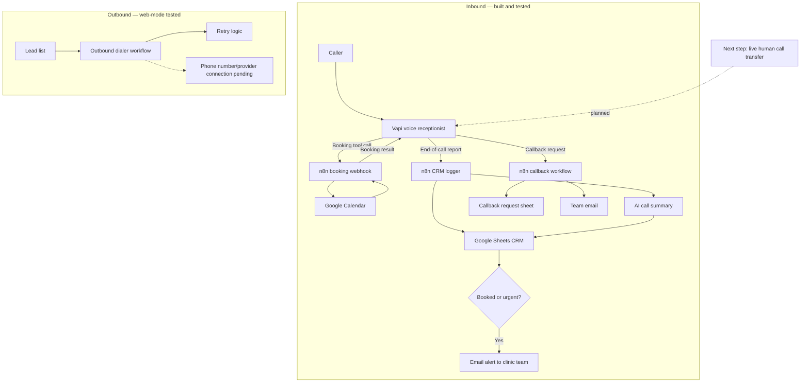

# AI Voice Receptionist for a Dental Clinic

An AI-powered receptionist for a dental clinic, built with Vapi and n8n. The system handles inbound enquiries, qualifies callers, books appointments in Google Calendar, records call outcomes in a Google Sheets CRM, and alerts the clinic team when action is needed.

The project also includes an outbound dialer workflow that has been built and tested in web mode. It includes a lead list and retry logic and is ready to be connected to a phone number. **Real outbound phone calls have not yet been tested.**

## Demo

**Inbound demo video:** [Watch the AI Voice Receptionist Demo on Loom](https://www.loom.com/share/6e319909b2a3402ba227402bd240f459)

## The problem

Small clinics can miss enquiries when staff are busy with patients. Important caller details may be recorded inconsistently, appointment requests can require repeated manual work, and urgent calls need to reach the team quickly.

This project demonstrates how voice AI and workflow automation can help a clinic respond consistently, capture useful information, and reduce repetitive administration.

## What is built and tested

### Inbound receptionist

- Answers inbound calls using a natural-sounding voice (Ava, the receptionist for the demonstration clinic, Bright Smile Dental).
- Qualifies callers and collects their name, phone number, preferred date and time, reason for visit, and whether they are a new or existing patient.
- Asks callers to spell their names and reads the spelling back to reduce speech-to-text errors.
- Books appointments in Google Calendar through an n8n tool workflow.
- Confirms an appointment only after the booking workflow returns success.
- Handles booking failures with a separate response path and offers a callback instead of claiming that an unsuccessful booking was completed.

### CRM and team notifications

After a call, the system logs a CRM record in Google Sheets with:

- Caller or patient details and lead status
- Appointment details, where applicable
- An AI-generated call summary
- The full call transcript
- A link to the call recording
- Call outcome and duration information

The clinic team receives email alerts for new bookings and urgent calls.

### Callback handoff

When a caller needs a person to follow up, the receptionist can capture a callback request. The request is logged to a Google Sheet and emailed to the team so that staff can follow up. This is a callback request workflow, not a live transfer of the active call.

### Outbound dialer

- The outbound dialer workflow has been built and tested in web mode.
- It uses a lead list and includes retry logic.
- The workflow is prepared for connection to a phone number/provider.
- **It has not yet placed or verified real outbound calls to people.** Do not interpret web-mode testing as a completed phone-call test.

## Feature status at a glance

| Capability | Status |
|---|---|
| Inbound AI receptionist | Built and tested |
| Caller qualification and name-spelling confirmation | Built and tested |
| Google Calendar appointment booking | Built and tested |
| Booking failure handling | Built and tested |
| CRM logging with lead status, AI summary, transcript and recording link | Built and tested |
| Email alerts for bookings and urgent calls | Built and tested |
| Callback request logged to a sheet and emailed to the team | Built and tested |
| Outbound lead list, dialer workflow and retry logic | Built and tested in web mode |
| Real outbound phone calls | Awaiting phone-number/provider connection and real-call testing |
| Live call transfer to a human receptionist | Planned; not yet built |

## Architecture

The inbound workflow and outbound workflow are separate paths. The diagram distinguishes the working inbound call path from the outbound dialer that has been tested in web mode but is not yet connected to a phone number.

## Project screenshots

### 1. Booking workflow

### 2. CRM logger workflow

### 3. Google Calendar appointment

### 4. Google Sheets CRM

> Add screenshots of the callback and outbound dialer workflows here when available.

## Tech stack

| Layer | Tool |
|---|---|
| Voice agent | Vapi |
| Conversation model | OpenAI (GPT-4.1 class) |
| Workflow orchestration | n8n |
| Calendar | Google Calendar |
| CRM and callback log | Google Sheets |
| Call summaries | Claude via n8n |
| Team notifications | Gmail |
| Outbound workflow testing | Web mode |

## How the inbound workflow works

**1. Appointment booking during the call.** Vapi's `book_appointment` function tool calls an n8n webhook. n8n extracts the arguments, creates a 30-minute Google Calendar event in the `Africa/Lagos` time zone, and returns the result in the format Vapi expects. If the calendar step fails, a separate failure branch responds so Ava can apologise and offer a callback. The assistant confirms a booking only after a successful response.

**2. Call logging after the call.** Vapi sends an end-of-call report to a second n8n workflow. A Code node builds a CRM row, including the lead status. Claude generates a one-sentence summary. The record is appended to Google Sheets, and a parallel branch emails the team when the call is booked or urgent.

**3. Callback handoff.** If the caller requests follow-up from a staff member, the callback details are written to a sheet and an email is sent to the team. The workflow records a request for a callback; it does not transfer the live call.

**4. Outbound dialer.** The outbound workflow uses a lead list and retry logic and has been tested in web mode. Connecting it to a phone number/provider and testing real outbound calls remain outstanding.

### Lead status rules

| Status | When |
|---|---|
| Booked | The booking tool returned success |
| Urgent - call back | The caller mentioned pain, swelling, bleeding, or an emergency requiring staff attention |
| No answer | The call ended in voicemail or with no pickup |
| Follow up | Any other call requiring follow-up |

## Problems solved

| Problem | Solution |
|---|---|
| The prompt told Ava not to promise appointments while also requiring her to book them. | Restructured the prompt into clear sections for booking, communication, rules and emergency handling. |
| The n8n workflow struggled with Vapi's tool-call payload structure. | Used a Code node to extract and process the incoming tool-call data. |
| Ava confirmed appointments even when booking failed. | Added success and failure response paths and instructed Ava to confirm only after a successful tool response. |
| Vapi tool parameter names were incorrectly formatted after pasting. | Recreated the four tool parameters using their exact required names and data types. |
| AI summarisation returned a 400 error due to a deprecated model option. | Removed the deprecated option, made summarisation non-blocking, and separated CRM writing and email alerts into parallel branches. |
| Google Sheets output replaced the original call data needed by downstream email alerts. | Routed the alert from the merged data branch rather than relying on the Sheets node output. |
| Speech recognition misinterpreted patient names. | Added name-spelling confirmation and adjusted Vapi endpointing settings. |
| A hard-coded date caused incorrect interpretation of relative dates. | Used Vapi's dynamic date variable and configured the assistant for the Africa/Lagos time zone. |
| Booking failures could leave the caller without a clear next step. | Added a failure-handling path that offers a callback rather than falsely confirming an appointment. |

## Repository contents

| Path | Description |
|---|---|
| `prompts/ava-system-prompt.md` | Ava's system prompt and receptionist instructions |
| `n8n/extract-booking-details.js` | Code node that extracts appointment details from incoming tool calls |
| `n8n/build-crm-row.js` | Code node that processes call reports, determines lead status and prepares CRM records |
| `n8n/booking-workflow.json` | Sanitised export of the appointment booking workflow |
| `n8n/crm-logger-workflow.json` | Sanitised export of call logging and email notification workflow |
| `screenshots/booking-workflow.png` | Appointment booking workflow screenshot |
| `screenshots/crm-logger-workflow.png` | CRM logging workflow screenshot |
| `screenshots/google-calendar-booking.png` | Google Calendar appointment screenshot |
| `screenshots/google-sheets-crm.png` | Google Sheets CRM screenshot |

The outbound dialer and callback workflow are described above; add their export and screenshot paths to this table if/when they are committed to the repository.

## Run it yourself

1. **Set up Vapi:** Create a Vapi assistant and configure it using `prompts/ava-system-prompt.md`.
2. **Import the n8n workflows:** Import `n8n/booking-workflow.json` and `n8n/crm-logger-workflow.json`.
3. **Configure credentials and placeholders:** Reconnect Google Calendar, Google Sheets, Gmail and AI model credentials. Replace the placeholder spreadsheet ID and email address in the CRM logger workflow.
4. **Configure Google Calendar:** Connect the appropriate calendar and use 30-minute appointments in the `Africa/Lagos` time zone.
5. **Create the Vapi booking tool:** Create a function tool named `book_appointment` with string parameters `patient_name`, `phone`, `date_time` (ISO 8601), and `reason`. Set its endpoint to the booking workflow webhook URL in n8n.
6. **Configure call reporting:** Set the Vapi assistant's Server URL to the CRM logger webhook URL and enable the `end-of-call-report` server message.
7. **Set up the CRM spreadsheet:** Create a Google Sheet with these headers: `Call Time, Call ID, Patient Name, Phone, Lead Status, Appointment Time, Reason, Summary, Transcript, Recording URL, Ended Reason, Duration (sec)`.
8. **Test the inbound system:** Verify appointment booking, failure handling, CRM logging, lead status classification, callback requests and email notifications.
9. **Outbound setup:** Review the outbound workflow, configure the supported phone-number/provider integration, and test with an authorised test number before describing real outbound calling as operational. The web-mode test alone does not establish that phone calls have been placed.

## Next steps

- Connect the outbound dialer to a phone number/provider and test real outbound calls with appropriate consent.
- Build and test live call transfer to a human receptionist.
- Consider post-call SMS or email confirmations and follow-ups.
- Add webhook authentication using shared secrets.
- Improve error monitoring and operational alerts for failed bookings and call-processing workflows.

## Disclaimer

This project is a demonstration of AI-powered workflow automation for a dental clinic.

- It is not intended for production clinical use.
- The AI receptionist does not diagnose conditions or provide medical advice.
- Callers reporting emergencies are directed to emergency services.
- The CRM uses a Google Sheets-based demonstration setup.
- A production deployment would require appropriate privacy, security, access controls, data protection compliance and clinical oversight.
- Outbound calling must be configured with an appropriate phone provider and used in accordance with applicable consent, privacy and telecommunications requirements.

## About me

I'm Bisi, a pharmacist and AI Automation Specialist transitioning into healthcare data analytics. I build data-driven solutions and automated workflows that improve processes, support decision-making and reduce repetitive tasks.

**Tools:** Excel, SQL, Power BI, Python, n8n, Zapier, API integrations and AI-powered automation.
