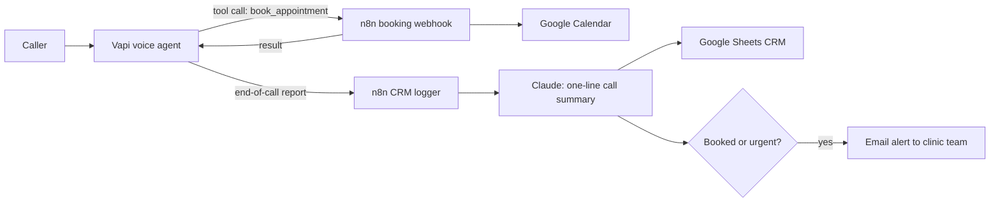
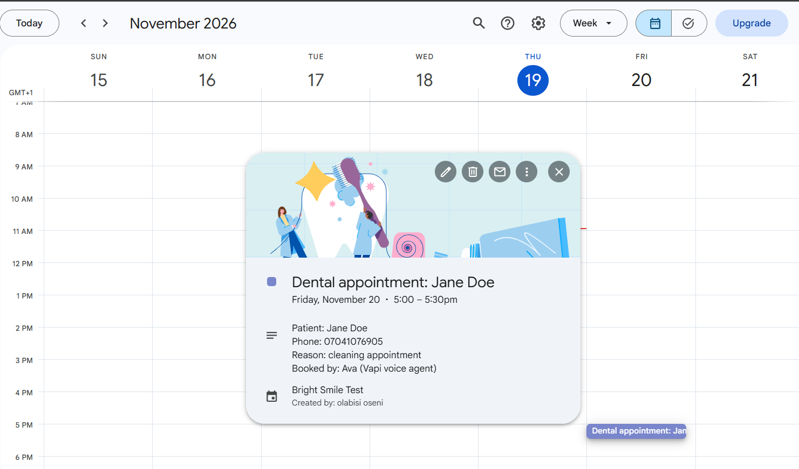
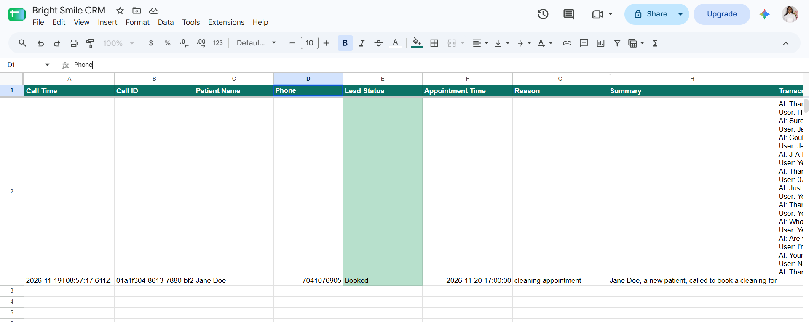

# AI Voice Receptionist for a Dental Clinic

An AI phone receptionist that answers calls, qualifies the caller, books the appointment, and writes every call into a CRM with an AI-generated summary. The clinic team gets an email alert for new bookings and urgent calls. No manual data entry.

## Demo

**Demo video:** [Watch the AI Voice Receptionist Demo on Loom](https://www.loom.com/share/6e319909b2a3402ba227402bd240f459)

## The problem

Small clinics miss calls and lose leads. Staff are busy with patients, calls go to voicemail, and details from calls that are answered end up on sticky notes instead of in a system.

## What it does

- Answers inbound calls with a natural voice (Ava, the receptionist for the demo clinic "Bright Smile Dental")
- Collects name, phone number, preferred date and time, reason for visit, and new or existing patient
- Asks the caller to spell their name and reads it back to catch speech-to-text mistakes
- Books the appointment live in Google Calendar through a tool call, and confirms only after the booking succeeds
- After every call, logs a row to a Google Sheets CRM: patient, phone, appointment time, lead status, AI summary, full transcript, recording link
- Assigns a lead status: **Booked**, **Urgent - call back**, **No answer**, or **Follow up**
- Emails the clinic team for booked and urgent calls
- Sends emergencies (severe bleeding, trouble breathing) to emergency services and never gives medical advice

## Architecture

## Project Screenshots

### 1. Booking Workflow

### 2. CRM Logger Workflow

### 3. Google Calendar Appointment

### 4. Google Sheets CRM

## Tech stack

| Layer | Tool |
|---|---|
| Voice agent | Vapi |
| Live conversation model | OpenAI (GPT-4.1 class) |
| Orchestration | n8n |
| Calendar | Google Calendar |
| CRM | Google Sheets |
| Call summaries | Claude (via n8n) |
| Alerts | Gmail |

## How it works

**1. Booking (live, during the call).** Vapi's `book_appointment` function tool calls an n8n webhook. n8n extracts the arguments, creates a 30-minute Google Calendar event in the Africa/Lagos time zone, and replies in the format Vapi expects. If the calendar step fails, a separate failure branch still replies, so Ava apologises and offers a callback instead of going silent.

**2. Logging (after the call).** Vapi sends an end-of-call report to a second n8n workflow. A Code node builds one row from it, including the lead status. Claude writes a one-sentence summary. The row is appended to Google Sheets, and a parallel branch emails the team for booked or urgent calls.

**Lead status rules**

| Status | When |
|---|---|
| Booked | The booking tool returned success |
| Urgent - call back | The caller mentioned pain, swelling, bleeding, or an emergency |
| No answer | The call ended in voicemail or with no pickup |
| Follow up | Anything else |

## Problems I Hit and How I Fixed Them

| **Problem** | **Fix** |
|---|---|
| The prompt instructed Ava not to promise appointments while also requiring her to book them, resulting in inconsistent behaviour. | Restructured the prompt into clearly defined sections for booking, communication, rules and emergency handling. |
| The n8n workflow had difficulty handling Vapi's tool-call payload structure. | Replaced the Set node with a Code node to extract and process the incoming tool-call data. |
| Ava confirmed appointments even when the booking tool failed. | Added success and failure response paths to the webhook and instructed Ava to confirm bookings only after receiving a successful response. |
| Vapi tool parameter names were incorrectly formatted after pasting, causing unreliable tool calls. | Recreated the four tool parameters using their exact required names and data types. |
| The AI summarisation step returned a 400 error due to a deprecated model option, interrupting the workflow. | Removed the deprecated option, made the summary step non-blocking, and separated the CRM write and email alert into parallel branches. |
| The Google Sheets node returned spreadsheet fields instead of the original call data, affecting downstream email alerts. | Routed the email alert from the merged data branch instead of relying on the Google Sheets node output. |
| Speech recognition misinterpreted patient names, making accurate records difficult. | Added name-spelling confirmation and adjusted Vapi endpointing settings to allow callers to spell their names clearly. |
| A hard-coded date in the prompt caused incorrect interpretation of relative dates such as "tomorrow". | Replaced the hard-coded date with Vapi's dynamic date variable and configured the assistant for the Africa/Lagos timezone. |

## Repository Contents

| **Path** | **What it is** |
|---|---|
| `prompts/ava-system-prompt.md` | Ava's system prompt and receptionist instructions |
| `n8n/extract-booking-details.js` | Code node that extracts appointment booking details from incoming tool calls |
| `n8n/build-crm-row.js` | Code node that processes call reports, determines lead status, and prepares CRM records |
| `n8n/booking-workflow.json` | Sanitised export of the n8n appointment booking workflow |
| `n8n/crm-logger-workflow.json` | Sanitised export of the n8n call logging and email notification workflow |
| `screenshots/booking-workflow.png` | Screenshot of the appointment booking workflow |
| `screenshots/crm-logger-workflow.png` | Screenshot of the CRM logging workflow |
| `screenshots/google-calendar-booking.png` | Screenshot of a booked appointment in Google Calendar |
| `screenshots/google-sheets-crm.png` | Screenshot of the CRM record in Google Sheets |

## Run It Yourself

1. **Set up Vapi:** Create a Vapi assistant and configure it using the system prompt in `prompts/ava-system-prompt.md`.

2. **Import the n8n workflows:** Import `n8n/booking-workflow.json` and `n8n/crm-logger-workflow.json` into your n8n instance.

3. **Configure credentials and placeholders:** Reconnect your Google Calendar, Google Sheets, Gmail and AI model credentials. Replace the placeholder spreadsheet ID and email address in the CRM logger workflow with your own values.

4. **Configure Google Calendar:** Connect the appropriate calendar and configure the booking workflow to create 30-minute appointments using the `Africa/Lagos` timezone.

5. **Create the Vapi booking tool:** Create a function tool named `book_appointment` with the following string parameters:
   - `patient_name`
   - `phone`
   - `date_time` (ISO 8601 format)
   - `reason`

   Set the tool's endpoint to the booking workflow webhook URL in n8n.

6. **Configure call reporting:** Set the Vapi assistant's Server URL to the CRM logger webhook URL in n8n and enable the `end-of-call-report` server message.

7. **Set up the CRM spreadsheet:** Create a Google Sheet and add the following headers in row 1:

   `Call Time, Call ID, Patient Name, Phone, Lead Status, Appointment Time, Reason, Summary, Transcript, Recording URL, Ended Reason, Duration (sec)`

8. **Test and activate:** Test appointment booking, call logging, lead status classification and email notifications. Once everything works as expected, activate both n8n workflows.
   
## Roadmap

- [ ] Outbound calls to leads, with voicemail detection and retry cadence
- [ ] Post-call text or email to the caller
- [ ] Warm transfer to a human, with a callback fallback
- [ ] Shared-secret authentication on the webhooks

## Disclaimer

This project is a demonstration of AI-powered workflow automation for a dental clinic.

- It is not intended for production clinical use.
- The AI receptionist does not diagnose conditions or provide medical advice.
- Callers reporting emergencies are directed to emergency services.
- The CRM uses a Google Sheets-based demonstration setup.
- A production deployment would require appropriate privacy, security, access controls, data protection compliance, and clinical oversight.

## About me

I'm Bisi, a data analytics and AI automation specialist. I build workflows that turn data into insights and automate repetitive business tasks.

