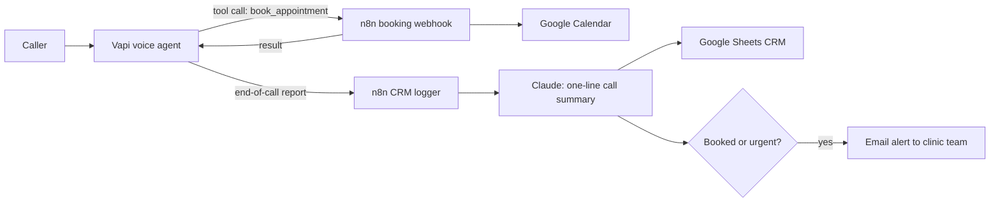

# AI Voice Receptionist for a Dental Clinic

An AI phone receptionist that answers calls, qualifies the caller, books the appointment, and writes every call into a CRM with an AI-generated summary. The clinic team gets an email alert for new bookings and urgent calls. No manual data entry.

> **Demo video:** _add your Loom/YouTube link here_

## The problem

Small clinics miss calls and lose leads. Staff are busy with patients, calls go to voicemail, and details from calls that are answered end up on sticky notes instead of in a system.

## What it does

- Answers inbound calls with a natural voice (Ava, the receptionist for the demo clinic "Bright Smile Dental")
- Collects name, phone number, preferred date and time, reason for visit, and new or existing patient
- Asks the caller to spell their name and reads it back to catch speech-to-text mistakes
- Books the appointment live in Google Calendar through a tool call, and confirms only after the booking succeeds
- After every call, logs a row to a Google Sheets CRM: patient, phone, appointment time, lead status, AI summary, full transcript, recording link
- Assigns a lead status: **Booked**, **Urgent - call back**, **No answer**, or **Follow up**
- Emails the clinic team for booked and urgent calls
- Sends emergencies (severe bleeding, trouble breathing) to emergency services and never gives medical advice

## Architecture

## Tech stack

| Layer | Tool |
|---|---|
| Voice agent | Vapi |
| Live conversation model | OpenAI (GPT-4.1 class) |
| Orchestration | n8n |
| Calendar | Google Calendar |
| CRM | Google Sheets |
| Call summaries | Claude (via n8n) |
| Alerts | Gmail |

## How it works

**1. Booking (live, during the call).** Vapi's `book_appointment` function tool calls an n8n webhook. n8n extracts the arguments, creates a 30-minute Google Calendar event in the Africa/Lagos time zone, and replies in the format Vapi expects. If the calendar step fails, a separate failure branch still replies, so Ava apologises and offers a callback instead of going silent.

**2. Logging (after the call).** Vapi sends an end-of-call report to a second n8n workflow. A Code node builds one row from it, including the lead status. Claude writes a one-sentence summary. The row is appended to Google Sheets, and a parallel branch emails the team for booked or urgent calls.

**Lead status rules**

| Status | When |
|---|---|
| Booked | The booking tool returned success |
| Urgent - call back | The caller mentioned pain, swelling, bleeding, or an emergency |
| No answer | The call ended in voicemail or with no pickup |
| Follow up | Anything else |

## Problems I hit and how I fixed them

| Problem | Fix |
|---|---|
| The prompt told Ava not to "promise an appointment" while also asking her to book one, so her behaviour was inconsistent | Rewrote the prompt with separate sections for booking, messages, rules, and emergencies |
| n8n blocks any expression that reads a field named `arguments`, and Vapi sends tool data in exactly that field, so the booking crashed | Replaced the Set node with a Code node that reads the payload safely and never throws |
| Ava said "booked" even though the tool had failed | Made the webhook always respond, added a failure path, and told Ava to confirm only after a success result |
| Vapi tool parameter names were corrupted by pasted text and worked only because the model guessed | Recreated the four parameters with exact names |
| The AI summary step used a model option that is now deprecated, returned a 400 error, and stopped the whole chain, so no rows were logged | Removed the option, made the summary step non-blocking, and ran the sheet write and email alert as parallel branches |
| The Sheets node outputs sheet column names, not the original call fields, which would have broken the alert branch | Branched the alert off the merged row instead of the sheet node |
| Speech-to-text garbled names (for example "Demian Dhu" became "Demiandoux") | Added name-spelling confirmation and tuned Vapi's endpointing so Ava waits between letters |
| A hard-coded date in the prompt made "tomorrow" wrong | Switched to Vapi's live date variable with the Africa/Lagos time zone |

## Repository contents

| Path | What it is |
|---|---|
| `prompts/ava-system-prompt.md` | The receptionist's system prompt |
| `n8n/extract-booking-details.js` | Code node for the booking workflow |
| `n8n/build-crm-row.js` | Code node that turns an end-of-call report into a CRM row and lead status |
| `n8n/booking-workflow.json` | Exported n8n booking workflow (add after exporting, see below) |
| `n8n/crm-logger-workflow.json` | Exported n8n CRM logger workflow (add after exporting, see below) |

## Run it yourself

1. Create a Vapi assistant and paste in `prompts/ava-system-prompt.md`.
2. Import both workflow JSON files into n8n, connect your Google account, and publish them.
3. Create a Vapi function tool named `book_appointment` with string parameters `patient_name`, `phone`, `date_time` (ISO 8601), and `reason`, pointing at the n8n booking webhook.
4. Set the assistant's Server URL to the CRM logger webhook, with Server Messages set to `end-of-call-report`.
5. Create a Google Sheet with these headers in row 1: `Call Time, Call ID, Patient Name, Phone, Lead Status, Appointment Time, Reason, Summary, Transcript, Recording URL, Ended Reason, Duration (sec)`.

## Roadmap

- [ ] Outbound calls to leads, with voicemail detection and retry cadence
- [ ] Post-call text or email to the caller
- [ ] Warm transfer to a human, with a callback fallback
- [ ] Shared-secret authentication on the webhooks

## About me

I'm Bisi, a data analytics and AI automation specialist. I build workflows that turn data into insights and automate repetitive business tasks.

